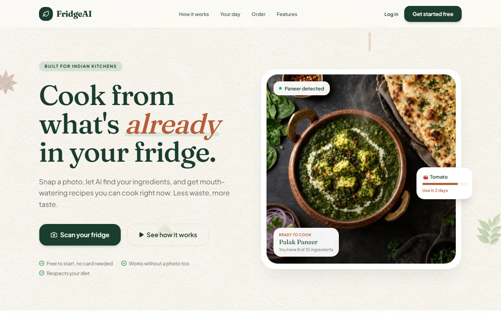
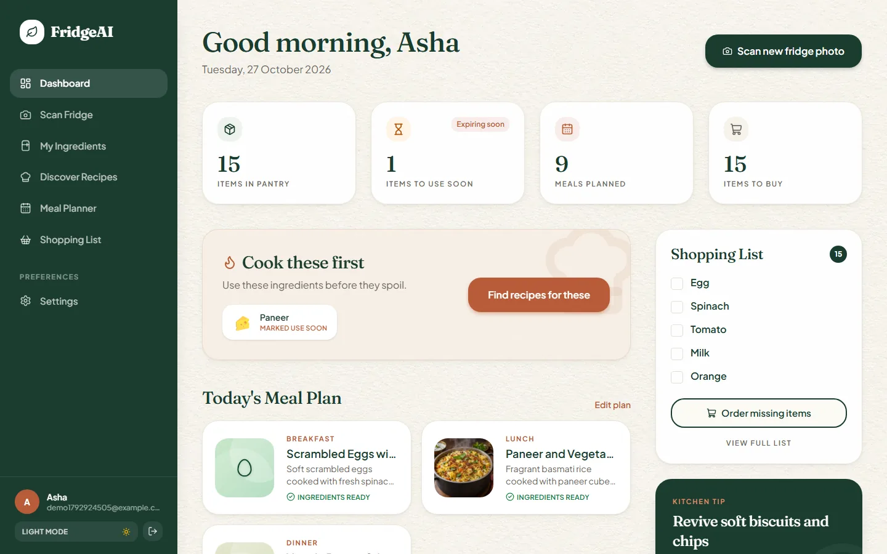
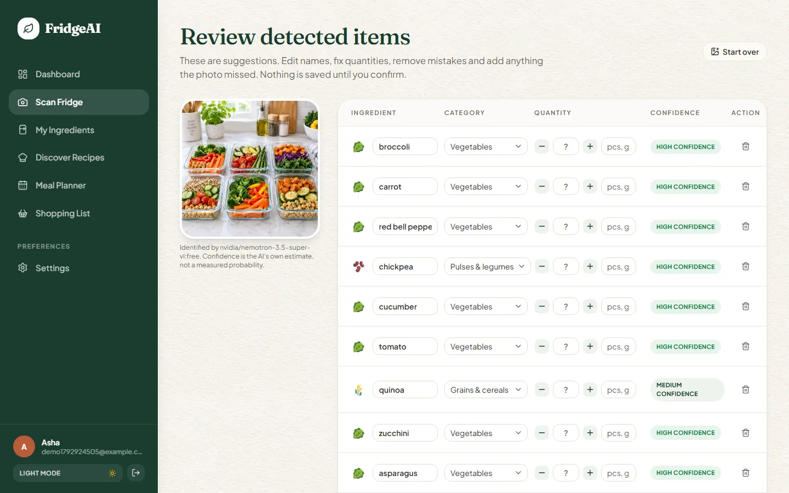
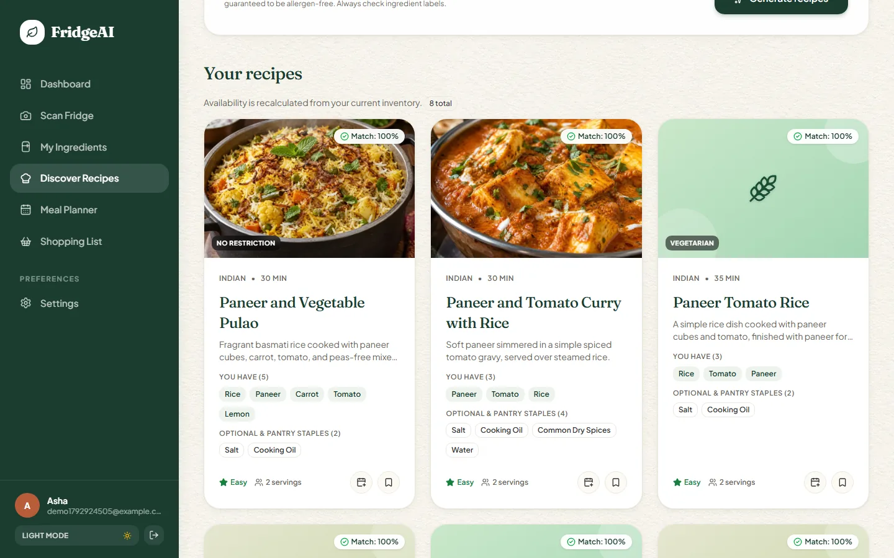
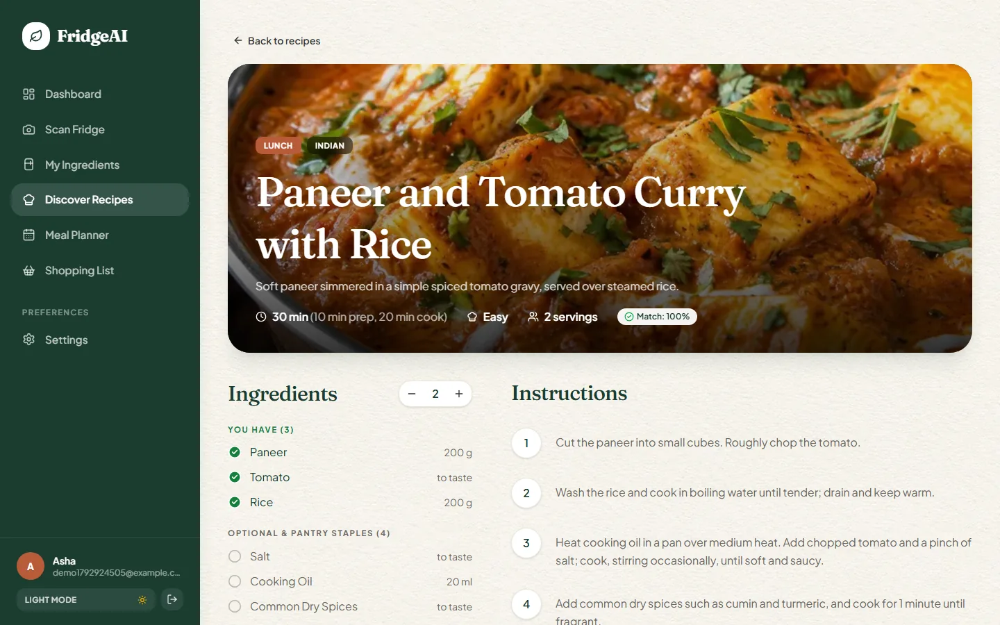
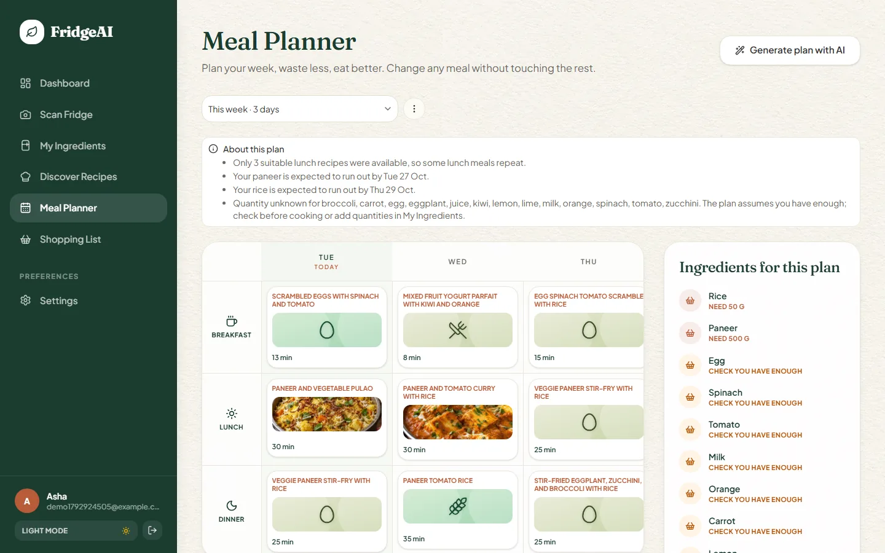
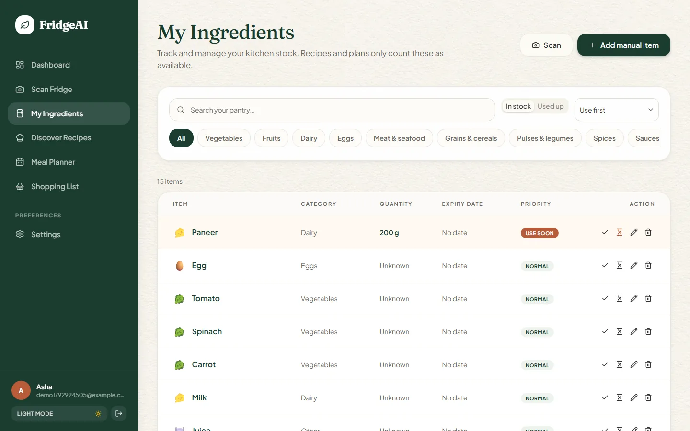
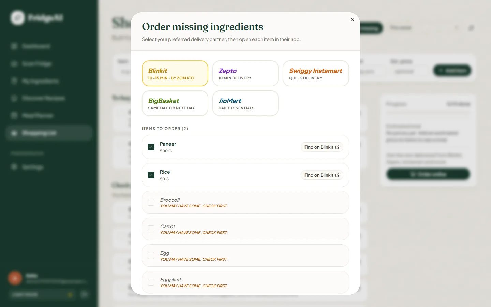
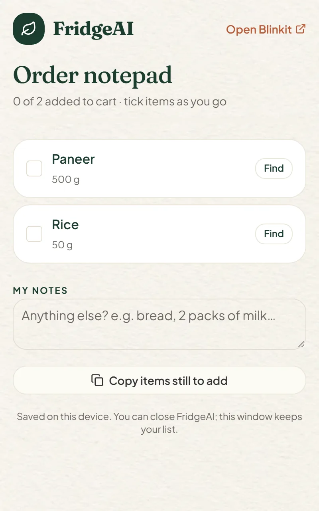
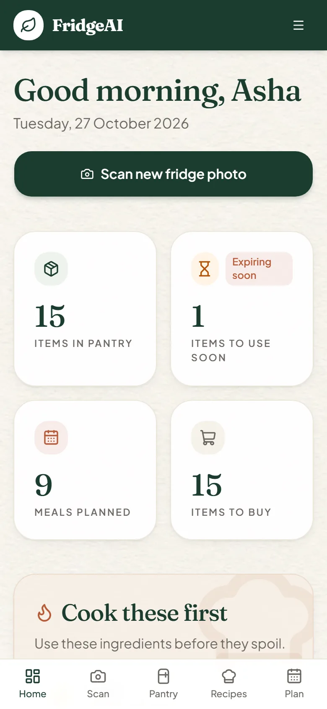

# FridgeAI

**Cook from what's already in your fridge.** Snap a photo of your fridge, let AI find the ingredients, get recipes you can cook right now, plan your week's meals, and order only what's missing from Blinkit, Zepto, Swiggy Instamart, BigBasket or JioMart.



## Features

| | |
|---|---|
| **AI fridge scan** | Upload a photo. A vision AI lists the ingredients it sees, with a confidence level. You review and edit everything; nothing is saved until you confirm. |
| **My Ingredients** | Your pantry: quantities, expiry dates, "use soon" items, search and category filters. |
| **Recipes you can cook now** | AI suggests recipes from your pantry. Each one shows a match %, what you have, and what's missing. Your diet, allergies and cooking time are respected. |
| **Meal planner** | An AI-built plan for breakfast, lunch and dinner over 1–7 days. Swap any single meal without touching the rest. |
| **Smart shopping list** | Built from your plan. Only buys what's missing, merges amounts across meals, and never mixes kg with pieces. |
| **Order online** | Opens each missing item in your chosen delivery app, or sends the list to your local kirana on WhatsApp. |
| **Order notepad** | A small pop-up checklist that stays open while you shop in Blinkit or another app, even after you close FridgeAI. |
| **Dashboard** | Pantry stats, items to cook first, today's meals, shopping list and a daily kitchen tip. |
| **Light and dark mode, mobile friendly** | Sidebar on desktop, bottom tabs on phones. |

## Screenshots

| Dashboard | AI scan review |
|---|---|
|  |  |
| **Recipes** | **Recipe detail** |
|  |  |
| **Meal planner** | **My Ingredients** |
|  |  |
| **Order missing items** | **Order notepad and phone view** |
|  |   |

## Tech stack

- **Frontend:** React 19, Vite, TypeScript, Tailwind CSS 4, shadcn/ui (Radix), TanStack Query, React Router, React Hook Form + Zod
- **Backend:** FastAPI, SQLAlchemy 2, Alembic, PostgreSQL, Pydantic, Argon2 passwords, JWT login
- **AI:** any OpenAI-compatible API. The default is OpenRouter with the free `nvidia/nemotron-3.5-super-vl:free` vision model.
- **Tests:** Pytest (53 tests) and Vitest + React Testing Library (29 tests)

## How it works

**The AI suggests; normal code decides.** The AI only lists ingredients and writes recipe ideas. Everything that must be correct is plain, tested code:
- checking diet and allergy rules
- working out what you have and what's missing (from your pantry, never from the AI's claims)
- ranking recipes
- assigning meals to the plan
- unit-safe shopping maths

## Run it locally

You need Python 3.12+, Node 20+ and Docker (for PostgreSQL).

```bash
# 1. Database
docker compose up -d

# 2. Backend  (http://localhost:8000, API docs at /docs)
cd backend
python -m venv .venv
.venv\Scripts\activate            # macOS/Linux: source .venv/bin/activate
pip install -r requirements-dev.txt
cp .env.example .env              # then fill in SECRET_KEY and AI_API_KEY
alembic upgrade head
uvicorn app.main:app --reload --port 8000

# 3. Frontend  (http://localhost:5173)
cd frontend
npm install
cp .env.example .env
npm run dev
```

Main settings in `backend/.env`:

| Variable | What it is |
|---|---|
| `SECRET_KEY` | Long random string. Make one with `python -c "import secrets; print(secrets.token_urlsafe(48))"` |
| `AI_API_KEY` | Your OpenRouter key (openrouter.ai). It stays on the server. |
| `AI_MODEL` | Default `nvidia/nemotron-3.5-super-vl:free`. It must support images and structured output. |
| `AI_MOCK_MODE` | `true` to try the app without a key. It returns clearly labelled sample data. |
| `CORS_ORIGINS` | Frontend address(es) allowed to call the API |

No Docker? Set `DATABASE_URL=sqlite:///./fridgeai.db` for local development.

## Tests

```bash
cd backend  && python -m pytest     # 53 tests, AI calls mocked
cd frontend && npm test             # 29 tests
cd frontend && npm run build        # type-check + production build
```

## Deploy

- **Frontend:** Vercel or Netlify. Set the root to `frontend` and `VITE_API_URL=https://your-api`. Route all paths to `index.html`.
- **Backend:** Render or Koyeb. Set the root to `backend` and the start command to `alembic upgrade head && uvicorn app.main:app --host 0.0.0.0 --port $PORT`. Set `ENVIRONMENT=production`, `SECRET_KEY`, `DATABASE_URL`, the `AI_*` variables and `CORS_ORIGINS`.
- **Database:** Neon (free PostgreSQL). Use a `postgresql+psycopg://…` URL.

## Security and privacy

- Keys and secrets come only from environment variables. `.env` is git-ignored.
- Photos are checked by their real bytes and re-encoded to strip GPS/EXIF data. They are **never stored**.
- Every user sees only their own data. Rate limits apply to the AI and login routes.

## Known limitations

- Free AI models are slower and can miss items, which is why every scan is reviewed before saving.
- Recipes are filtered against your allergies but are **not guaranteed allergen-free**. Always check labels.
- Grocery apps don't let other sites fill your cart. FridgeAI opens each item in the app's search for you to add.
- No password reset or email verification yet.
- Dish photos appear only for common dishes (e.g. palak paneer, biryani, poha). Other recipes show an illustration.
